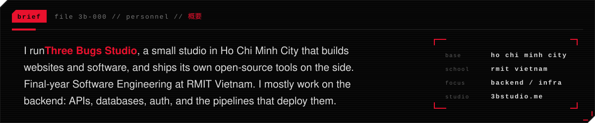


<a href="https://github.com/Three-Bugs-Studio/3bcad">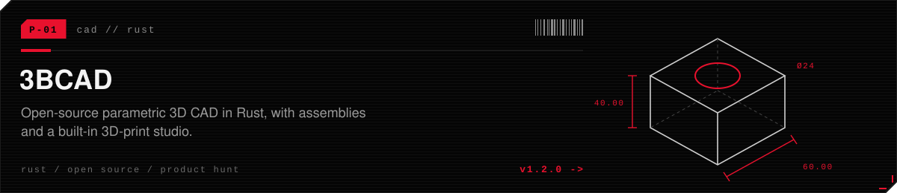</a>

<a href="https://3binfrastructure.vercel.app">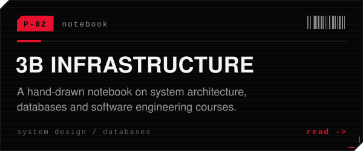</a>
<a href="https://github.com/DongDuong2001/pudo-code-system">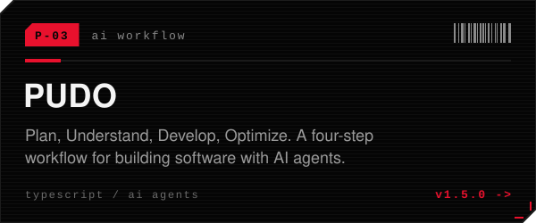</a>
<a href="https://github.com/Three-Bugs-Studio/3beditor">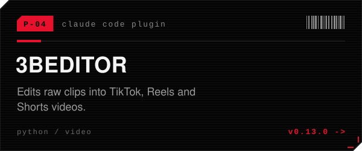</a>
<a href="https://github.com/Three-Bugs-Studio/threebugsworkspace">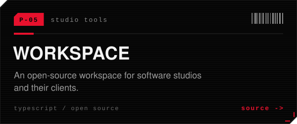</a>

3BCAD guide: [three-bugs-studio.github.io/3bcad](https://three-bugs-studio.github.io/3bcad/)

<a href="https://sukajanrandomphitruong.com/">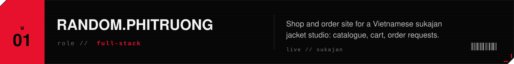</a>
<a href="https://lehongkhanh.vn/">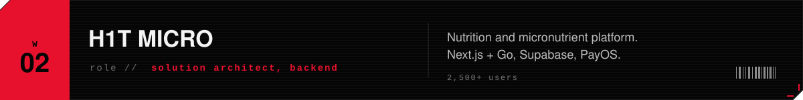</a>
<a href="https://www.rmitvn-showcase.com/nightswatch10f37c09">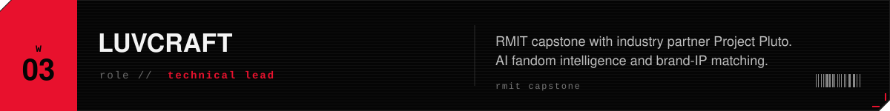</a>

| `P‑01` 3BCAD | `P‑02` 3B Infrastructure | `P‑03` PUDO | `W‑02` H1T MICRO |
| :-: | :-: | :-: | :-: |
| <a href="https://unikorn.vn/p/3bcad?ref=embed-3bcad"><picture><source media="(prefers-color-scheme: light)" srcset="https://unikorn.vn/api/widgets/badge/3bcad?theme=light"></picture></a> | <a href="https://unikorn.vn/p/3b-infrastructure?ref=embed-3b-infrastructure"><picture><source media="(prefers-color-scheme: light)" srcset="https://unikorn.vn/api/widgets/badge/3b-infrastructure?theme=light"></picture></a> | <a href="https://unikorn.vn/p/pudo?ref=embed-pudo"><picture><source media="(prefers-color-scheme: light)" srcset="https://unikorn.vn/api/widgets/badge/pudo?theme=light"></picture></a> | <a href="https://unikorn.vn/p/h1t-micro?ref=embed-h1t-micro"><picture><source media="(prefers-color-scheme: light)" srcset="https://unikorn.vn/api/widgets/badge/h1t-micro?theme=light"></picture></a> |

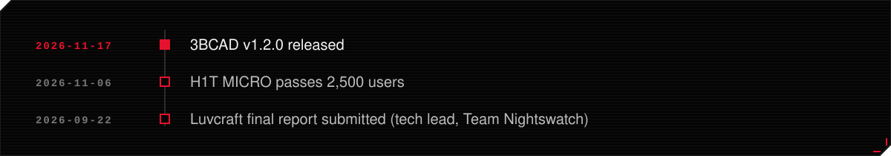

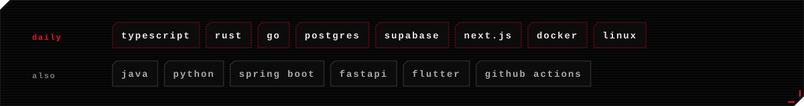

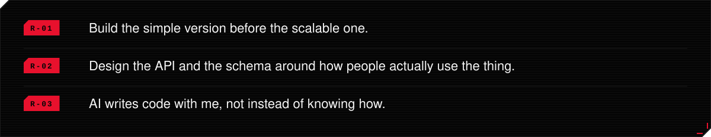

`REV 2026-11-27` · Three Bugs Studio · Ho Chi Minh City · if something here helped you, [sponsor](https://github.com/sponsors/DongDuong2001) or [buy a coffee](https://ko-fi.com/dongphuduong)
