`P-00 / readme` &nbsp;·&nbsp; [3bstudio.me](https://3bstudio.me) &nbsp;·&nbsp; [LinkedIn](https://www.linkedin.com/in/duong-phu-dong/) &nbsp;·&nbsp; [Email](mailto:dongduong840@gmail.com) &nbsp;·&nbsp; [Portfolio](https://duongphudong2001.vercel.app/)

I run **[Three Bugs Studio](https://3bstudio.me)**, a small studio in Ho Chi Minh City that builds websites and software, and ships its own open-source tools on the side. Final-year Software Engineering at RMIT Vietnam. I mostly work on the backend: APIs, databases, auth, and the pipelines that deploy them.

---

### `01 / products`

Things the studio makes and maintains in the open.

| No. | Product | What it is |
| :-- | :------ | :--------- |
| `P‑01` | **[3BCAD](https://github.com/Three-Bugs-Studio/3bcad)** · [guide](https://three-bugs-studio.github.io/3bcad/) | Open-source parametric 3D CAD in Rust, with a built-in 3D-print studio and assemblies. `v1.0.1` <br><a href="https://unikorn.vn/p/3bcad?ref=embed-3bcad"><picture><source media="(prefers-color-scheme: light)" srcset="https://unikorn.vn/api/widgets/badge/3bcad?theme=light"></picture></a> |
| `P‑02` | **[3B Infrastructure](https://3binfrastructure.vercel.app)** | A hand-drawn notebook on system architecture, databases and software engineering courses. <br><a href="https://unikorn.vn/p/3b-infrastructure?ref=embed-3b-infrastructure"><picture><source media="(prefers-color-scheme: light)" srcset="https://unikorn.vn/api/widgets/badge/3b-infrastructure?theme=light"></picture></a> |
| `P‑03` | **[PUDO](https://github.com/DongDuong2001/pudo-code-system)** | Plan → Understand → Develop → Optimize. A four-step workflow for building software with AI agents. <br><a href="https://unikorn.vn/p/pudo?ref=embed-pudo"><picture><source media="(prefers-color-scheme: light)" srcset="https://unikorn.vn/api/widgets/badge/pudo?theme=light"></picture></a> |
| `P‑04` | **[3beditor](https://github.com/Three-Bugs-Studio/3beditor)** | A Claude Code plugin that edits raw clips into TikTok, Reels and Shorts videos. |
| `P‑05` | **[Workspace](https://github.com/Three-Bugs-Studio/threebugsworkspace)** | An open-source workspace for software studios and their clients. |

### `02 / work`

Built with partners and clients.

| No. | Project | Role | Notes |
| :-- | :------ | :--- | :---- |
| `W‑01` | **[H1T MICRO](https://lehongkhanh.vn/)** | Backend, architecture | Nutrition and micronutrient platform. Next.js + Go, Supabase, PayOS. 2,500+ users. <br><a href="https://unikorn.vn/p/h1t-micro?ref=embed-h1t-micro"><picture><source media="(prefers-color-scheme: light)" srcset="https://unikorn.vn/api/widgets/badge/h1t-micro?theme=light"></picture></a> |
| `W‑02` | **[Luvcraft](https://www.rmitvn-showcase.com/nightswatch10f37c09)** | Technical lead | RMIT capstone with industry partner Project Pluto. AI fandom intelligence and brand–IP matching. |
| `W‑03` | **[FortifyKitchen](https://fortifykitchen.vercel.app/)** | Full-stack | Ordering and checkout for a high-protein meal-prep kitchen. |
| `W‑04` | **[Demuse](https://demuse-two.vercel.app/)** | Full-stack | Schedule planner with conflict detection, reminders and `.ics` sync. |

### `03 / log`

```text
2026-11-10  3BCAD v1.0.1 released
2026-11-06  H1T MICRO passes 2,500 users
2026-09-22  Luvcraft final report submitted (tech lead, Team Nightswatch)
```

### `04 / stack`

```text
daily     typescript  rust  go  postgres  supabase  next.js  docker  linux
also      java  python  spring boot  fastapi  flutter  github actions
```

### `05 / rules`

1. Build the simple version before the scalable one.
2. Design the API and the schema around how people actually use the thing.
3. AI writes code with me, not instead of knowing how.

---

<sub>`REV 2026-11-11` · Three Bugs Studio · Ho Chi Minh City · if something here helped you, [sponsor](https://github.com/sponsors/DongDuong2001) or [buy a coffee](https://ko-fi.com/dongphuduong)</sub>
